<div align="center">

# ESCUELA POLITÉCNICA NACIONAL
### Facultad de Ingeniería de Sistemas

**Asignatura:** Business Intelligence
**Paralelo:** GR2SW

## Práctica 4. Modelo físico dimensional en PostgreSQL

**Integrantes:**
- Alvaro Montalvan
- Ruben Cuenca
- Jonathan Cuasapaz
- Jeremy Jimenez

**Fecha:** 26/10/2026

</div>

---

## Índice

1. [Introducción](#intro)
2. [Objetivos](#objetivos)
3. [Desarrollo](#desarrollo)
   - 3.1 [Parte A. Carga de products.csv](#parte-a)
   - 3.2 [Parte B. Modelo estrella de ventas](#parte-b)
   - 3.3 [Consultas de ventas](#consultas)
4. [Conclusiones](#conclusiones)
5. [Referencias](#referencias)
6. [Declaración de uso de inteligencia artificial](#ia)

---

## Índice de figuras

- Figura 1. Menú Import/Export Data
- Figura 2. Configuración general de la importación
- Figura 3. Opciones de la importación (Header activado)
- Figura 4. Columnas que se importan
- Figura 5. Resultado de la validación de stg_products
- Figura 6. Diagrama del modelo estrella en Power Pivot
- Figura 7. Comparación entre staging y modelo estrella
- Figuras 8 a 12. Resultados de las cinco consultas de ventas

## Índice de tablas

- Tabla 1. Tablas del modelo y sus campos

---

<a id="intro"></a>
## 1. Introducción

Esta práctica construye una parte de un Data Warehouse en PostgreSQL. Con `products.csv` se documenta la carga de datos en staging y su validación y limpieza, y con `Tabla_Desnormalizada_Ventas.csv` se modela un esquema estrella de ventas. Se trabajó en pgAdmin 4 con PostgreSQL 18, y el diagrama del modelo se elaboró en Power Pivot de Excel.

<a id="objetivos"></a>
## 2. Objetivos

- Construir en PostgreSQL un modelo dimensional tipo estrella a partir de archivos CSV, siguiendo todo el proceso: importar los datos, revisarlos y limpiarlos, cargarlos en dimensiones y tabla de hechos, y documentar el diseño con un diagrama en Power Pivot.
- Comprobar, con consultas SQL, que el modelo dimensional sirve para analizar la información del negocio de forma simple y confiable.

<a id="desarrollo"></a>
## 3. Desarrollo

<a id="parte-a"></a>
### 3.1 Parte A. Carga de products.csv

#### Importación de products.csv

La carga se hace desde la opción **Import/Export Data** de la tabla de staging `stg_products` (Figura 1). Configuración usada:

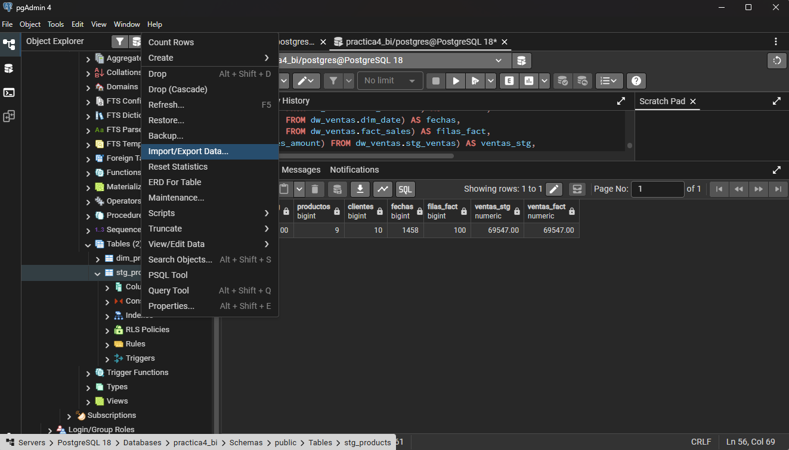

*Figura 1. Menú Import/Export Data.*

General: formato CSV y codificación UTF8 (Figura 2).

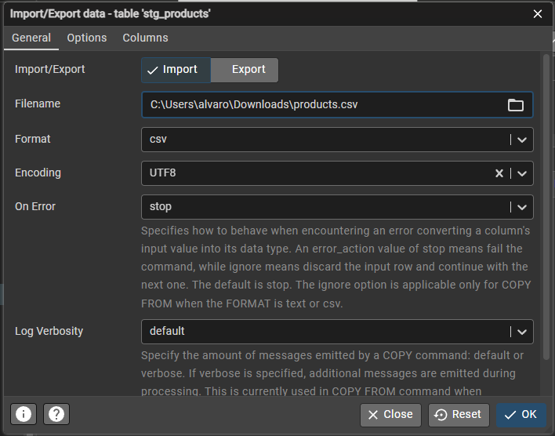

*Figura 2. Configuración general de la importación CSV.*

Options: Header activado porque la primera fila trae los encabezados, y coma como separador (Figura 3).

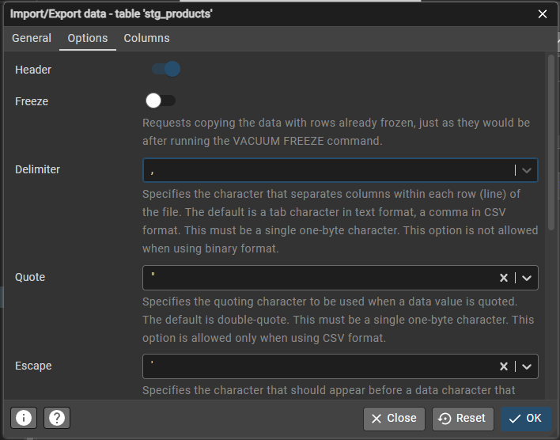

*Figura 3. Header activado para indicar que la primera fila tiene encabezados.*

Columns: las cuatro columnas de la tabla, en el orden del archivo (Figura 4).

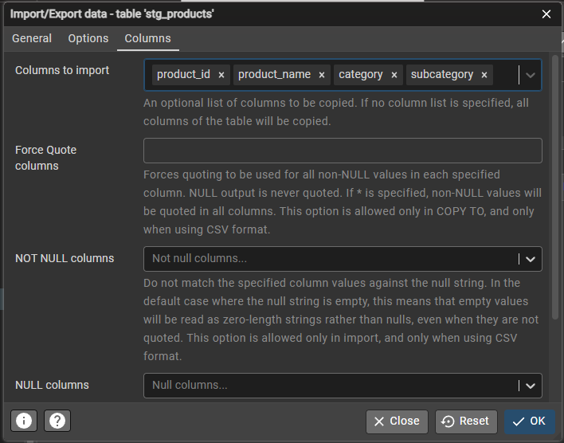

*Figura 4. Columnas que se importan.*

#### Validación

Consulta de validación sobre `stg_products` (Figura 5):

```sql
SELECT COUNT(*) AS total_registros,
       COUNT(DISTINCT product_id) AS productos_unicos,
       COUNT(DISTINCT category) AS categorias,
       COUNT(DISTINCT subcategory) AS subcategorias,
       COUNT(*) - COUNT(DISTINCT product_id) AS ids_duplicados,
       COUNT(*) FILTER (WHERE product_id IS NULL
                        OR product_id = '') AS ids_nulos
FROM stg_products;
```

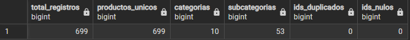

*Figura 5. Resultado de la validación de stg_products.*

Hay 699 registros con 699 `product_id` únicos, 10 categorías y 53 subcategorías, sin IDs duplicados ni nulos.

#### Limpieza

Algunos nombres traen tabulaciones y espacios repetidos. La limpieza se aplica sobre staging, sin tocar el archivo original:

```sql
UPDATE stg_products
SET product_name = btrim(regexp_replace(product_name, '\s+', ' ', 'g')),
    category     = btrim(category),
    subcategory  = btrim(subcategory);
```

Primero se cambian las tabulaciones y los espacios repetidos por un solo espacio, y después se quitan los espacios del inicio y del final. Si se hiciera al revés, una tabulación al inicio (como en `P0000`) se convertiría en un espacio que ya no se quitaría. Después de la limpieza ningún nombre tiene espacios de más.

<a id="parte-b"></a>
### 3.2 Parte B. Modelo estrella de ventas

#### Diseño del modelo

1. **Proceso de negocio:** venta de productos a clientes. Cada línea de pedido registra qué producto se vendió, a qué cliente, cuándo se ordenó y se envió, y por cuánto.
2. **Granularidad:** una fila por cada línea de pedido.
3. **Medidas:** `quantity`, `unit_price`, `product_cost`, `sales_amount`.
4. **Clave de hechos principal:** `order_number` + `order_line_number`.
5. **Dimensiones:** producto, cliente y fecha.

#### Creación y carga del modelo

El modelo se construyó con dos scripts SQL de la carpeta `sql/`: [01_ddl.sql](sql/01_ddl.sql) crea las tablas y [02_dml.sql](sql/02_dml.sql) valida, limpia y carga los datos. Las consultas de la sección 3.3 están en [03_consultas.sql](sql/03_consultas.sql).

**Creación de las tablas (01_ddl.sql).** Se crearon cinco tablas. La Tabla 1 muestra los campos de cada una.

**Tabla 1.** Tablas del modelo y sus campos

| Tabla | Clave | Campos |
|---|---|---|
| stg_ventas | — | Todas las columnas del archivo de ventas, sin cambios |
| dim_product | product_key | product_code, source_product_key, product_name, list_price, color, size, category, subcategory |
| dim_customer | customer_key | customer_id, birth_date, marital_status, gender, income, children, home_owner, cars |
| dim_date | date_key | full_date, year, quarter, month_number, month_name, year_month, day_of_month, day_name |
| fact_sales | order_number + order_line_number | product_key, customer_key, order_date_key, ship_date_key, quantity, unit_price, product_cost, sales_amount |

Las claves de las tres dimensiones son claves sustitutas. En fact_sales, las columnas que terminan en _key apuntan a esas dimensiones y el resto son las medidas de la venta.

**Validación y limpieza (02_dml.sql).** En stg_ventas se revisó que no hubiera campos vacíos, que cantidad × precio fuera igual al importe y que ningún envío fuera anterior a su orden. Luego se quitaron los espacios sobrantes de los textos y se pasó el género a mayúscula.

**Carga de las dimensiones (02_dml.sql).** dim_product y dim_customer se llenaron con los campos de producto y de cliente de stg_ventas, sin repetir registros. dim_date se generó con una fila por cada día entre la primera y la última fecha de las ventas, y sus campos de año, trimestre, mes y día se calcularon a partir de la fecha.

**Carga de fact_sales (02_dml.sql).** Cada fila de stg_ventas se unió con dim_product por el código del producto y con dim_customer por el identificador del cliente, para obtener las claves sustitutas. Las claves de fecha se sacaron de la fecha de orden y de envío en formato AAAAMMDD. Las medidas pasaron igual.

#### Diagrama en Power Pivot


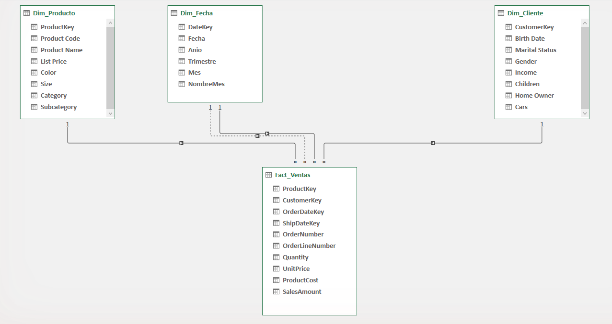

*Figura 6. Diagrama del modelo estrella en Power Pivot.*


Comparación entre staging y modelo estrella (Figura 7):

```sql
SELECT 'Filas de ventas' AS comprobacion,
       (SELECT COUNT(*) FROM dw_ventas.stg_ventas) AS staging,
       (SELECT COUNT(*) FROM dw_ventas.fact_sales) AS modelo_estrella
UNION ALL
SELECT 'Ventas totales',
       (SELECT SUM(sales_amount) FROM dw_ventas.stg_ventas),
       (SELECT SUM(sales_amount) FROM dw_ventas.fact_sales)
UNION ALL
SELECT 'Productos',
       (SELECT COUNT(DISTINCT product_code) FROM dw_ventas.stg_ventas),
       (SELECT COUNT(*) FROM dw_ventas.dim_product)
UNION ALL
SELECT 'Clientes',
       (SELECT COUNT(DISTINCT customer_key_src) FROM dw_ventas.stg_ventas),
       (SELECT COUNT(*) FROM dw_ventas.dim_customer)
UNION ALL
SELECT 'Fechas', NULL,
       (SELECT COUNT(*) FROM dw_ventas.dim_date);
```

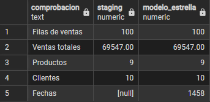

*Figura 7. Comparación entre staging y modelo estrella.*

En staging, las fechas salen `NULL` porque ahí no hay una tabla de fechas: cada venta solo trae `order_date` y `ship_date`. Los 1 458 registros de `dim_date` se generaron al cargar el modelo, uno por cada día entre la primera y la última fecha de las ventas.

<a id="consultas"></a>
### 3.3 Consultas de ventas

#### 1. ¿Cuántas ventas se realizaron por categoría de producto y mes?


```sql
SELECT p.category AS categoria,
       d.year_month AS mes,
       COUNT(*) AS num_ventas,
       SUM(f.sales_amount) AS importe_ventas
FROM dw_ventas.fact_sales f
JOIN dw_ventas.dim_product p ON p.product_key = f.product_key
JOIN dw_ventas.dim_date d ON d.date_key = f.order_date_key
GROUP BY p.category, d.year_month
ORDER BY d.year_month, p.category;
```

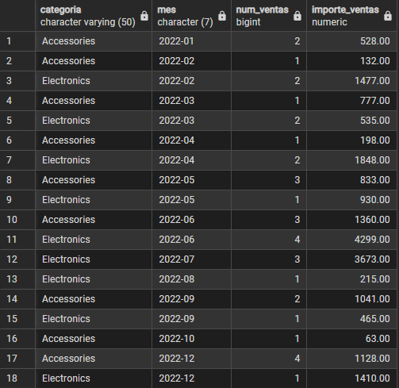

*Figura 8. Ventas por categoría de producto y mes.*

Los datos solo tienen dos categorías: Accessories y Electronics (Figura 8).

#### 2. ¿Cuál es el ingreso total (ventas) por cliente y género?

```sql
SELECT c.customer_id AS cliente,
       c.gender AS genero,
       SUM(f.sales_amount) AS ingreso_total
FROM dw_ventas.fact_sales f
JOIN dw_ventas.dim_customer c ON c.customer_key = f.customer_key
GROUP BY c.customer_id, c.gender
ORDER BY ingreso_total DESC;
```

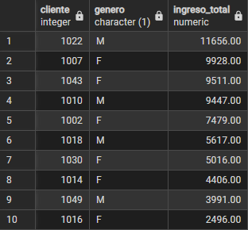

*Figura 9. Ingreso total por cliente y género.*

El cliente 1022 (M) es el que más compra, con 11 656.00 (Figura 9). Le siguen el cliente 1007 (F) con 9 928.00 y el 1043 (F) con 9 511.00. El que menos compra es el 1016 (F), con 2 496.00.

#### 3. ¿Cuál es la cantidad total vendida por producto?

```sql
SELECT p.product_code,
       p.product_name,
       SUM(f.quantity) AS cantidad_total
FROM dw_ventas.fact_sales f
JOIN dw_ventas.dim_product p ON p.product_key = f.product_key
GROUP BY p.product_code, p.product_name
ORDER BY cantidad_total DESC, p.product_code;
```

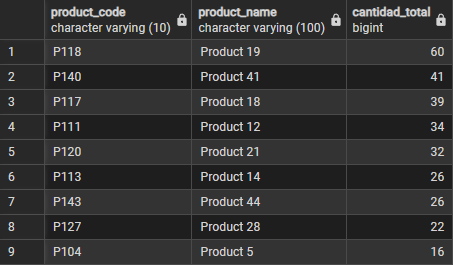

*Figura 10. Cantidad total vendida por producto.*

El producto más vendido es Product 19 (P118), con 60 unidades (Figura 10). El que menos se vendió es Product 5 (P104), con 16.

#### 4. ¿Cuál fue la cantidad enviada por mes de envío?

Usa el rol de fecha de envío (`ship_date_key`).

```sql
SELECT d.year_month AS mes_envio,
       SUM(f.quantity) AS cantidad_enviada
FROM dw_ventas.fact_sales f
JOIN dw_ventas.dim_date d ON d.date_key = f.ship_date_key
GROUP BY d.year_month
ORDER BY d.year_month;
```

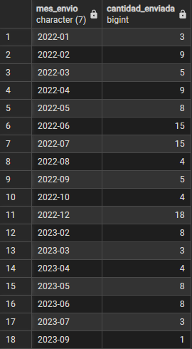

*Figura 11. Cantidad enviada por mes de envío.*

Hay envíos en 41 meses (Figura 11). Los máximos de 2022 fueron junio y julio, con 15 unidades cada uno.

#### 5. ¿Cuánto se vendió por tamaño de producto y por estado civil del cliente?

```sql
SELECT p.size AS tamano,
       c.marital_status AS estado_civil,
       SUM(f.sales_amount) AS total_vendido
FROM dw_ventas.fact_sales f
JOIN dw_ventas.dim_product p ON p.product_key = f.product_key
JOIN dw_ventas.dim_customer c ON c.customer_key = f.customer_key
GROUP BY p.size, c.marital_status
ORDER BY p.size, c.marital_status;
```

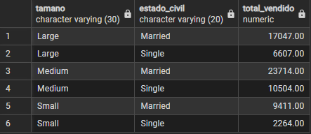

*Figura 12. Ventas por tamaño de producto y estado civil.*

Los clientes casados compran más en los tres tamaños (Figura 12), y Medium es el tamaño que más vende. Las seis filas suman 69 547.00, igual que el total de ventas.

<a id="conclusiones"></a>
## 4. Conclusiones

- Se cumplió el primer objetivo: se construyó el modelo dimensional tipo estrella en PostgreSQL a partir de los archivos CSV. Se siguió el proceso completo, desde la importación y limpieza de los datos hasta su carga en las dimensiones y en la tabla de hechos, y el diagrama de Power Pivot dejó documentado el diseño. La comparación con staging confirmó que no se perdió ningún dato.
- Se cumplió el segundo objetivo: el modelo sirve para analizar la información del negocio. Las cinco consultas de ventas se resolvieron con la tabla de hechos y una o dos dimensiones, y sus totales coincidieron con los datos cargados, por lo que el análisis resultó simple y confiable.

<a id="referencias"></a>
## 5. Referencias

Microsoft. (s. f.). *Create a relationship between two tables in Power Pivot*. Microsoft Support. https://support.microsoft.com/

pgAdmin Development Team. (s. f.). *pgAdmin 4 documentation*. https://www.pgadmin.org/docs/

PostgreSQL Global Development Group. (s. f.). *PostgreSQL 18 documentation*. https://www.postgresql.org/docs/18/

<a id="ia"></a>
## 6. Declaración de uso de inteligencia artificial

Se usó Claude (Anthropic) en aproximadamente un 25 % del trabajo, como ayuda con los scripts SQL, el formato del informe y la corrección de ortografía, gramática y coherencia.
